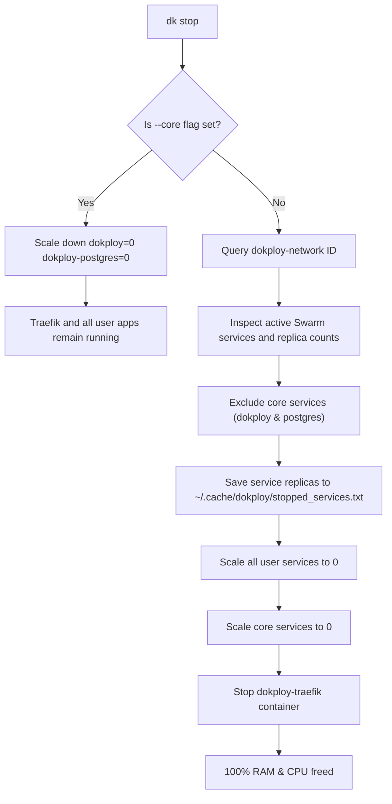

# Dokploy Local CLI (Universal Linux)

A fast, lightweight, and extensible Command-Line Interface (CLI) designed for local [Dokploy](https://dokploy.com) development. Engineered to run smoothly across **all Linux distributions** (Ubuntu, Debian, Fedora, Arch Linux, CentOS/RHEL, Alpine, openSUSE, etc.).

---

## 🌟 Key Features

- **Custom Command Prefix / Word:**
  - Choose your preferred invocation word: `dok start`, `dk start`, or `dokploy start`.
  - Configurable via installation variable, command-line arguments, or environment variables.
  - Out of the box, both `dok` and `dk` are symlinked and work interchangeably.
- **Universal Linux Compatibility:**
  - Standard, portable Bash and POSIX constructs without distro-specific package dependencies.
  - Automatic directory resolution: `/usr/local/bin` (root) or `~/.local/bin` (non-root).
  - Smart Docker daemon and user permission checks with actionable troubleshooting guidance.
- **Optimized Resource Management (Freeing CPU & RAM):**
  - `--core` mode allows stopping/starting only the Dokploy web panel and Postgres database, keeping your deployed applications and reverse proxy online.
  - Full `stop` scans all active Swarm services and containers on the Dokploy network, persists their exact replica counts to disk, and cleanly halts them to free 100% system memory.
  - Full `start` automatically restores all previously active applications to their exact prior state.
- **Developer-Centric Workflows:**
  - Real-time service & container status monitor (`status`, `ps`).
  - Unified log streaming for panel, database, proxy, or any user service (`logs panel -f`, `logs db`, `logs traefik`).
  - One-command browser dashboard launcher (`open`, `ui`).
  - Docker cleanup utility for dangling images and build cache (`clean`, `prune`).
  - Dynamic alias manager (`alias add <name>`).
- **Rich Tab Auto-Completion:**
  - Native tab completion for both **Bash** and **Zsh**, covering all subcommands, targets, and flags.

---

## 🚀 How to Install

### 📋 Prerequisites
- Any Linux distribution (Ubuntu, Debian, Fedora, Arch, CentOS/RHEL, Alpine, openSUSE, etc.)
- [Docker](https://docs.docker.com/engine/install/) installed and running.
- Ensure your user has Docker permissions without sudo:
  ```bash
  sudo usermod -aG docker $USER
  # Log out and log back in for changes to take effect
  ```

---

### Method 1: One-Line Remote Install (Recommended)
You do not need to clone the repository. Run this one-line curl command in your terminal:

```bash
# 1. Default Install ('dok' as primary command, with 'dk' and 'dokploy' aliases):
curl -fsSL https://raw.githubusercontent.com/showayebDev/dokploy-local-cli/main/install.sh | bash

# 2. Or install with 'dk' as your primary command:
curl -fsSL https://raw.githubusercontent.com/showayebDev/dokploy-local-cli/main/install.sh | bash -s -- dk

# 3. Or install the CLI AND set up Dokploy locally with auto-boot disabled:
curl -fsSL https://raw.githubusercontent.com/showayebDev/dokploy-local-cli/main/install.sh | bash -s -- --install-dokploy

# 4. System-wide installation (for all users / root):
curl -fsSL https://raw.githubusercontent.com/showayebDev/dokploy-local-cli/main/install.sh | sudo bash
```

---

### Method 2: Git Clone & Local Install
If you prefer to clone the repository locally or customize the source files:

```bash
# 1. Clone the repository
git clone https://github.com/showayebDev/dokploy-local-cli.git
cd dokploy-local-cli

# 2. Make scripts executable
chmod +x install.sh dok uninstall.sh

# 3. Run the installer:
# Option A: Interactive prompt (choose 'dok', 'dk', or custom)
./install.sh

# Option B: Pass 'dk' directly as an argument
./install.sh dk

# Option C: Use environment variable
CLI_NAME=dk ./install.sh

# Option D: Install CLI and install Dokploy locally in one step
./install.sh --install-dokploy
```

> [!TIP]
> **Both `dok` and `dk` are always available!** The installer creates automatic symlinks for `dok`, `dk`, and `dokploy`. Regardless of which command prefix you choose, you can use `dok start` or `dk start` interchangeably.

---

### ✅ Post-Installation & Verification

1. **Verify installation:**
   ```bash
   dok -v
   # or
   dk status
   ```

2. **Activate tab auto-completion in your current terminal session:**
   ```bash
   # If you use Zsh:
   source ~/.zshrc

   # If you use Bash:
   source ~/.bashrc
   ```

---

## 📋 Command Reference

All commands can be invoked using either `dok` or `dk`:

| Command | Short Alias | Description |
| :--- | :--- | :--- |
| `dok start` | `dk up` | Start Dokploy core (Panel + DB), Traefik proxy, and restore all saved user applications |
| `dok start --core` | `dk up -c` | Start only the Dokploy core panel and DB (skips restoring user applications) |
| `dok stop` | `dk down` | Save state of running user apps and stop everything (frees 100% CPU & RAM) |
| `dok stop --core` | `dk down -c` | Stop only the Dokploy dashboard & DB (user apps and Traefik stay running) |
| `dok restart` | `dk restart` | Restart Dokploy core and user applications |
| `dok status` | `dk ps` | Display real-time status of Dokploy core, Traefik proxy, apps, and access URLs |
| `dok logs panel -f`| `dk log panel -f`| Stream live logs from the Dokploy web dashboard |
| `dok logs db` | `dk log db` | View logs from the Dokploy PostgreSQL database |
| `dok logs traefik`| `dk log traefik` | View logs from the Traefik reverse proxy container |
| `dok logs <name>` | `dk log <name>` | View logs of any user-deployed Swarm service or container |
| `dok open` | `dk ui` | Open the Dokploy dashboard (`http://localhost:3000`) in your default browser |
| `dok clean` | `dk prune` | Prune stopped containers, dangling images, and build cache |
| `dok install-dokploy`| `dk install-dokploy`| Install Dokploy locally and automatically remove boot auto-startup |
| `dok disable-autostart`| `dk disable-autostart`| Remove auto-startup of Dokploy and Traefik on system boot |
| `dok autostart status`| `dk autostart status`| Check whether boot auto-startup is enabled or disabled |
| `dok autostart enable`| `dk autostart enable`| Re-enable automatic startup on boot |
| `dok alias add <name>`| `dk alias add` | Create an additional command alias (e.g. `dok alias add dp`) |
| `dok alias list` | `dk alias list` | List all active binary paths and symlinks |
| `dok update` | `dk update` | Update Dokploy Local CLI to the latest version from GitHub |
| `dok uninstall` | `dk uninstall` | Completely uninstall the CLI and remove shell completions |
| `dok version` | `dk -v` | Display CLI version and Dokploy image release tag |
| `dok help` | `dk -h` | Display the interactive help menu |

---

## 📦 Installing Dokploy & Disabling Auto-Startup

By default, official Dokploy is designed for servers, so it configures Docker Swarm and Traefik to auto-start on every system reboot (`--restart always`), consuming RAM and CPU continuously in the background.

With this CLI, you have complete control over Dokploy for local development:

### 1. Install Dokploy and automatically remove auto-startup:
```bash
# Using the CLI directly:
dok install-dokploy

# Or during CLI installation:
./install.sh --install-dokploy
```
This runs the official installer, immediately configures Traefik to `--restart=no`, sets Swarm services to `restart-condition=none`, and scales services to 0 so no background resources are wasted.

### 2. Disable auto-startup on an existing Dokploy installation:
If you already installed Dokploy previously, remove its boot auto-startup with:
```bash
dk disable-autostart
# Or:
dk autostart disable
```

### 3. Check auto-startup status:
```bash
dk autostart status
```
Outputs:
```text
Dokploy Auto-Startup Status:
  Traefik container restart policy: no
  Dokploy panel restart condition:  none
  Dokploy database restart condition: none

Status: Auto-startup is DISABLED. (Dokploy only runs on 'dk start')
```

---

## 🛠️ Detailed Usage & Workflow

### 1. Core Mode vs. Full Mode

During local development, you often do not need the heavy web panel running while testing your deployed APIs or frontend apps:

```bash
# Stop only the Dokploy management UI (frees RAM, keeps your apps & Traefik running):
dk stop --core

# Re-open the management panel when you need to configure services:
dk start --core
```

When you are done with development for the day:
```bash
# Safely records running services to ~/.cache/dokploy/ and halts all containers:
dk stop
```



---

### 2. Inspecting Logs

Quickly debug deployments, database migrations, or reverse proxy routes:

```bash
# Follow Dokploy panel logs:
dok logs panel -f

# Check last 50 lines of Postgres logs:
dok logs db --tail 50

# Inspect Traefik reverse proxy logs:
dok logs traefik

# Inspect a specific user application:
dok logs my-custom-app -f
```

---

### 3. Service Status

```bash
dk status
```
Outputs:
- **Core Dokploy Services**: Replicas, Swarm mode, and image version.
- **Traefik Proxy**: Container status and mapped ports (`80`, `443`).
- **User Applications**: All deployed applications on the `dokploy-network`.
- **Dashboard URL**: Direct link to `http://localhost:3000`.

---

## ⚙️ Configuration File

Settings are saved in your user configuration directory:
`~/.config/dokploy-cli/config`

```bash
CLI_NAME="dok"
DOKPLOY_PORT=3000
DOKPLOY_NETWORK="dokploy-network"
STATE_DIR="$HOME/.cache/dokploy"
```

---

## ⌨️ Shell Tab Auto-Completion

The installer automatically integrates completion hooks into `~/.bashrc` and `~/.zshrc`.

- Pressing `dok <TAB>` or `dk <TAB>` lists all available commands.
- Pressing `dok start <TAB>` or `dk stop <TAB>` autocompletes flags like `--core`.
- Pressing `dok logs <TAB>` suggests `panel`, `db`, `traefik`, or options like `-f`.

To activate autocompletion in your active terminal:
```bash
# For Zsh:
source ~/.zshrc

# For Bash:
source ~/.bashrc
```

---

## 🗑️ How to Uninstall

You can cleanly uninstall the Dokploy Local CLI at any time using any of the following methods:

### Method 1: Using the CLI Directly (Easiest)
If the CLI is already installed on your system, simply run:

```bash
dok uninstall
# or:
dk uninstall

# Skip confirmation prompt:
dok uninstall -y
```

---

### Method 2: One-Line Remote Uninstall (via curl)
If you don't have the repository cloned on your machine:

```bash
curl -fsSL https://raw.githubusercontent.com/showayebDev/dokploy-local-cli/main/install.sh | bash -s -- --uninstall
```

---

### Method 3: From the Local Repository
If you have cloned the repository locally:

```bash
./uninstall.sh
# or:
./install.sh --uninstall
```

---

### 🧹 What gets cleaned up during uninstall?
- **Executables & Symlinks**: Removes `dok`, `dk`, and `dokploy` binaries from `$HOME/.local/bin` (or `/usr/local/bin`).
- **Configuration**: Deletes the `~/.config/dokploy-cli` settings directory.
- **Shell Completions**: Cleanly strips out the completion blocks from both `~/.bashrc` and `~/.zshrc`.
- *(Note: Your Docker containers, Swarm volumes, and Dokploy data are completely preserved and untouched).*

