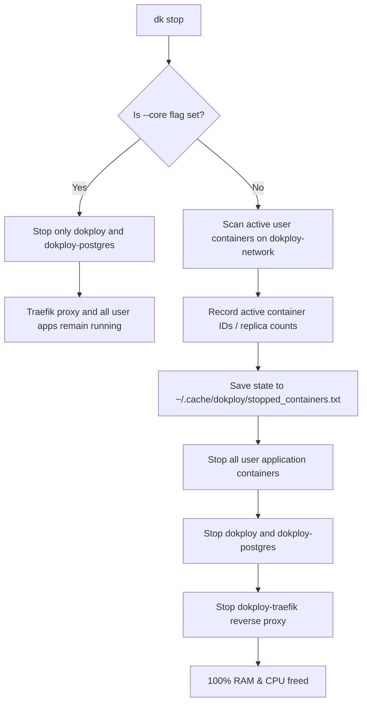

# Dokploy Local CLI (Windows, macOS, Linux)

A fast, lightweight, and extensible Command-Line Interface (CLI) designed for local [Dokploy](https://dokploy.com) development. Engineered to run seamlessly across **Windows**, **macOS**, and **Linux** distributions, supporting **Docker**, **Podman**, **Kiri**, and **Nerdctl (containerd)** container engines.

---

## 🚀 One-Line Quick Install

Install Dokploy Local CLI instantly with a single command in your terminal. **No Git cloning or manual file extraction required:**

### 🪟 Windows (PowerShell)
Open **PowerShell** (no Administrator rights needed) and run:

```powershell
irm https://raw.githubusercontent.com/showayebDev/dokploy-local-cli/main/install.ps1 | iex
```

### 🍎 macOS (Terminal / Zsh)
Open **Terminal** and run:

```bash
curl -fsSL https://raw.githubusercontent.com/showayebDev/dokploy-local-cli/main/install.sh | bash
```

### 🐧 Linux (Ubuntu, Debian, Fedora, Arch, Alpine, etc.)
Open your shell terminal and run:

```bash
# Standard user install:
curl -fsSL https://raw.githubusercontent.com/showayebDev/dokploy-local-cli/main/install.sh | bash

# Or system-wide install for all users (root):
curl -fsSL https://raw.githubusercontent.com/showayebDev/dokploy-local-cli/main/install.sh | sudo bash
```

> [!TIP]
> **Both `dok` and `dk` work out of the box!** The one-line installer automatically creates command shortcuts for both words and configures your system PATH. On Windows, it generates native `.cmd` wrappers (`dok.cmd`, `dk.cmd`, `dokploy.cmd`) so you can run them directly in PowerShell and CMD without execution policy issues.

---

## 🌟 Key Features

- **Universal Multi-OS Compatibility:**
  - **Windows:** First-class support for PowerShell, Command Prompt (CMD), Git Bash, and WSL 2.
  - **macOS:** Native support for Apple Silicon (M1/M2/M3/M4) and Intel (`x86_64`), native `open` browser launcher, and Colima/Podman machine socket discovery.
  - **Linux:** Portable POSIX compliance across all distributions (Ubuntu, Debian, Fedora, Arch, CentOS/RHEL, Alpine, openSUSE).
- **Multi-Container Engine Support:**
  - Auto-detects and orchestrates **Docker**, **Podman**, **Kiri**, and **Nerdctl**.
  - Dynamic engine switcher via `dok engine status`, `dok engine list`, and `dok engine set <engine>`.
- **Dual Orchestration Architecture:**
  - **Docker Swarm Mode:** Runs official Swarm services when Swarm orchestration is active.
  - **Standalone Container Mode:** Fully orchestrates Dokploy, Postgres, and Traefik in standalone container networks for runtimes without Swarm (such as Kiri, Podman, or standalone Docker).
- **Interchangeable Command Aliases (`dok` and `dk`):**
  - Choose your preferred invocation word: `dok start`, `dk start`, or `dokploy start`.
  - Both `dok` and `dk` are pre-linked and work interchangeably.
- **Optimized Resource Management (Freeing 100% CPU & RAM):**
  - `--core` mode allows stopping/starting only the Dokploy web panel and Postgres database while keeping deployed user applications and the reverse proxy online.
  - Full `stop` cleanly halts services and records running containers to free 100% system memory.
  - Full `start` automatically restores all previously active applications to their exact prior state.
- **Complete Reset Command (`dok reset`):**
  - Instant one-command wipe (`dok reset` or `dok reset -f`) to completely reset containers, databases, credentials, and volumes.
- **Developer-Centric Workflows:**
  - Real-time service & container status monitor (`status`, `ps`).
  - Unified log streaming (`logs panel -f`, `logs db`, `logs traefik`, `logs <app>`).
  - Cross-platform browser dashboard launcher (`open`, `ui`).
  - Rich Tab Auto-Completion for **Bash** and **Zsh**.

---

## 🐳 Supported Container Engines

Dokploy Local CLI automatically identifies your active runtime and selects the optimal orchestration strategy:

| Container Engine | Supported OS | Orchestration Mode | Socket Path |
| :--- | :--- | :--- | :--- |
| **Kiri** | Windows, Linux | Standalone Container Mode | `/var/run/docker.sock` |
| **Docker Engine** | Windows, macOS, Linux | Swarm Mode *(if active)* or Standalone | `/var/run/docker.sock` / `~/.docker/run/docker.sock` |
| **Podman** | Windows, macOS, Linux | Standalone Container Mode *(Rootless & Rootful)* | `/run/podman/podman.sock` / `$XDG_RUNTIME_DIR/podman/podman.sock` |
| **Nerdctl (containerd)**| Linux, macOS | Standalone Container Mode | `/run/containerd/containerd.sock` |

### Engine Management Commands:

```bash
# Check current active engine, mode, and socket details:
dok engine status
# or
dk engine

# List all container engines detected on your machine:
dok engine list

# Switch to a specific container engine:
dok engine set kiri       # Switch to Kiri
dok engine set podman     # Switch to Podman
dok engine set docker     # Switch to Docker
dok engine set nerdctl    # Switch to Nerdctl
dok engine set auto       # Re-enable auto-detection
```

---

## 📋 Command Reference

All commands can be invoked using either **`dok`** or **`dk`**:

| Command | Short Alias | Description |
| :--- | :--- | :--- |
| `dok start` | `dk up` | Start Dokploy core (Panel + DB), Traefik proxy, and restore all saved applications |
| `dok start --core` | `dk up -c` | Start only Dokploy core panel and DB (skips restoring user applications) |
| `dok stop` | `dk down` | Save state of running user apps and stop everything (frees 100% CPU & RAM) |
| `dok stop --core` | `dk down -c` | Stop only the Dokploy dashboard & DB (keeps user apps and Traefik running) |
| `dok restart` | `dk restart` | Restart Dokploy services and user containers |
| `dok status` | `dk ps` | Display platform, engine mode, container status, and dashboard access URL |
| `dok logs panel -f`| `dk log panel -f`| Stream real-time logs from the Dokploy web dashboard |
| `dok logs db` | `dk log db` | View logs from the Dokploy PostgreSQL database |
| `dok logs traefik`| `dk log traefik` | View logs from the Traefik reverse proxy container |
| `dok logs <name>` | `dk log <name>` | View logs of any user-deployed container or service |
| `dok open` | `dk ui` | Open the Dokploy dashboard (`http://localhost:3000`) in your default browser |
| `dok clean` | `dk prune` | Prune stopped containers, dangling images, and build artifacts |
| `dok reset` | `dk reset` | Completely reset Dokploy database, credentials, config, and containers |
| `dok reset -f` | `dk reset -f` | Force reset Dokploy without confirmation prompt |
| `dok engine status` | `dk engine` | Inspect active container engine and socket details |
| `dok engine list` | `dk engine list` | Show all available container engines on the host |
| `dok engine set <name>`| `dk engine set` | Set preferred default engine (`docker`, `podman`, `kiri`, `auto`) |
| `dok install-dokploy`| `dk install-dokploy`| Initialize Dokploy locally and disable boot auto-startup |
| `dok disable-autostart`| `dk disable-autostart`| Prevent Dokploy and Traefik from auto-starting on system boot |
| `dok autostart status`| `dk autostart status`| Check whether boot auto-startup is enabled or disabled |
| `dok autostart enable`| `dk autostart enable`| Re-enable automatic startup on boot |
| `dok alias add <name>`| `dk alias add` | Create an additional command alias (e.g. `dok alias add dp`) |
| `dok alias list` | `dk alias list` | List all active binary paths, wrappers, and symlinks |
| `dok update` | `dk update` | Update Dokploy Local CLI to the latest version from GitHub |
| `dok uninstall` | `dk uninstall` | Completely uninstall the CLI and remove shell completions |
| `dok version` | `dk -v` | Display CLI version, operating system, and container engine |
| `dok help` | `dk -h` | Display the interactive help menu |

---

## 🔄 Dokploy Complete Reset (`dok reset`)

If you want to start from scratch or wipe local test configurations:

```bash
# 1. Interactive reset (prompts for confirmation before wiping):
dok reset

# 2. Non-interactive force reset:
dok reset -f

# 3. Hard reset (wipes Dokploy core AND all deployed user applications/networks):
dok reset -f --hard
```

### What gets wiped during reset?
- `dokploy` web management container & session tokens.
- `dokploy-postgres` database & all admin credentials.
- `dokploy-traefik` proxy routing and local SSL certificates.
- Persistent volumes: `dokploy-postgres-data` and `dokploy-data`.
- CLI state cache in `~/.cache/dokploy/`.

To re-initialize Dokploy after a reset, simply run:
```bash
dok start
```

---

## 🛠️ Detailed Usage & Workflow

### 1. Core Mode vs. Full Mode (Resource Optimization)

During local development, you often do not need the heavy web panel running while testing your deployed APIs or frontend apps:

```bash
# Stop only the Dokploy management UI (frees RAM, keeps your apps & Traefik running):
dk stop --core

# Re-open the management panel when you need to configure services:
dk start --core
```

When you are done with development for the day:
```bash
# Safely records running services to ~/.cache/dokploy/ and halts all containers:
dk stop
```



---

### 2. Inspecting Logs

Quickly debug deployments, database migrations, or reverse proxy routes:

```bash
# Follow Dokploy panel logs:
dok logs panel -f

# Check last 50 lines of Postgres logs:
dok logs db --tail 50

# Inspect Traefik reverse proxy logs:
dok logs traefik

# Inspect a specific user application:
dok logs my-custom-app -f
```

---

### 3. Service & Platform Status

```bash
dok status
# or
dk ps
```

**Example Output:**
```text
======================================================
 Dokploy Local Development Status  (dok)
======================================================
Platform:           Windows
Container Engine:   Kiri Container Runtime

Engine Mode: Kiri Container Runtime (Standalone Mode)

Core Dokploy Containers:
NAMES              STATUS                    PORTS
dokploy-traefik    Up 30 minutes             0.0.0.0:80->80/tcp, 0.0.0.0:443->443/tcp
dokploy            Up 30 minutes (healthy)   0.0.0.0:3000->3000/tcp
dokploy-postgres   Up 30 minutes             

Dokploy User Applications:
NAMES              STATUS                    PORTS

● Dokploy Web Dashboard: http://localhost:3000
```

---

## ⚙️ Configuration File

Settings are saved in your user configuration directory at `~/.config/dokploy-cli/config`:

```bash
CLI_NAME="dok"
CONTAINER_ENGINE="kiri"
DOKPLOY_PORT=3000
DOKPLOY_NETWORK="dokploy-network"
STATE_DIR="$HOME/.cache/dokploy"
```

---

## ⌨️ Shell Tab Auto-Completion

The installer automatically integrates completion hooks into your shell configuration:
- **Bash:** `~/.bashrc`, `~/.bash_profile`
- **Zsh (macOS & Linux):** `~/.zshrc`, `~/.zprofile`

Pressing `<TAB>` after `dok` or `dk` provides dynamic suggestions:
- `dok <TAB>`: Displays all primary commands.
- `dok start <TAB>`: Suggests `--core` / `-c`.
- `dok engine <TAB>`: Suggests `status`, `list`, `set`.
- `dok logs <TAB>`: Suggests `panel`, `db`, `traefik`, `-f`, `--tail`.

To activate autocompletion in your active terminal:
```bash
# For Zsh:
source ~/.zshrc

# For Bash:
source ~/.bashrc
```

---

## 🗑️ How to Uninstall

You can cleanly uninstall the Dokploy Local CLI at any time:

### Method 1: Using the CLI Directly
```bash
dok uninstall -y
# or:
dk uninstall -y
```

### Method 2: One-Line Remote Uninstall
- **Windows (PowerShell):**
  ```powershell
  irm https://raw.githubusercontent.com/showayebDev/dokploy-local-cli/main/uninstall.ps1 | iex
  ```
- **macOS & Linux:**
  ```bash
  curl -fsSL https://raw.githubusercontent.com/showayebDev/dokploy-local-cli/main/install.sh | bash -s -- --uninstall
  ```

### 🧹 What gets cleaned up during uninstall?
- Removes executables (`dok`, `dk`, `dokploy`) and Windows `.cmd` wrappers from `~/.local/bin` (or `/usr/local/bin`).
- Removes configuration directory `~/.config/dokploy-cli`.
- Cleanly strips completion blocks from `~/.bashrc`, `~/.zshrc`, `~/.zprofile`, and `~/.bash_profile`.
- *(Note: Your container volumes and persistent data remain untouched unless you explicitly run `dok reset`).*

---

## 📄 License

MIT License. Designed and maintained for local Dokploy development.
